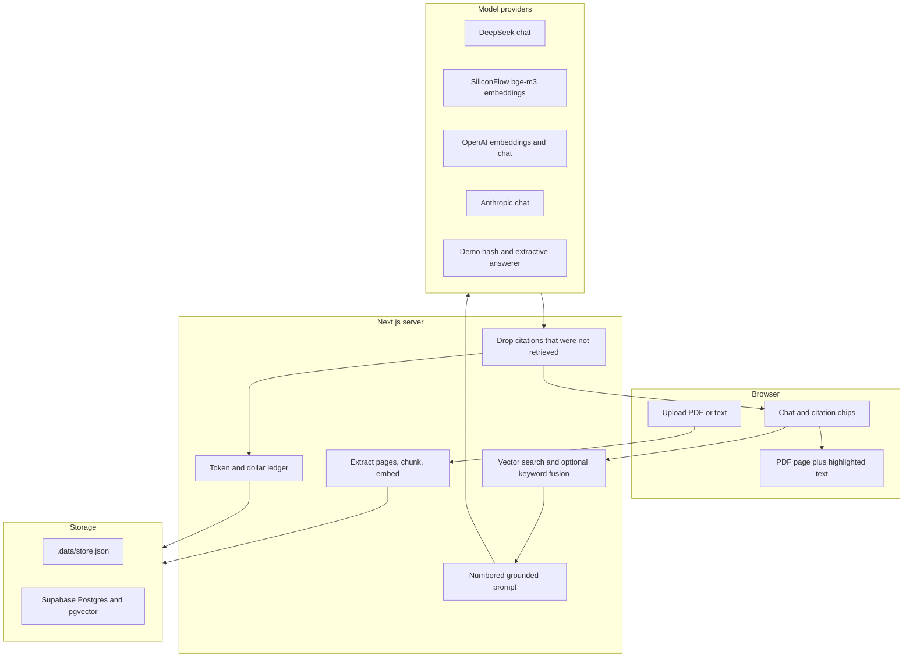

# Cited

Ask a document a question and check every claim. Each answer streams with numbered citations. Clicking `[1]` opens that page and highlights the passage the model was allowed to use. If the retrieved text does not support an answer, the app says so instead of guessing.

This is a small portfolio demo of the usual Upwork document-Q&A job: retrieval-augmented generation, traceable sources, and a visible cost meter.


## Run it locally in demo mode

No API keys and no Supabase project. Node 20+ and pnpm.

```bash
pnpm install
pnpm dev
```

Open http://localhost:3000, choose **Try the sample handbook**, ask a question (or click a suggestion), then click a citation chip. The banner stays on **Demo mode** so it is obvious that nothing is calling a paid API.

What demo mode actually does:

- Embeddings are a local hash into 1024 dimensions, not a hosted model.
- Answers are sentences copied from the retrieved passages, with real `[n]` markers.
- Files, chunks, and the cost ledger live in `.data/store.json` on this machine.
- Tracked spend stays at `$0.00`. An illustrative figure shows what the same token counts would have cost at `text-embedding-3-small` + `gpt-4o-mini` rates.

That JSON store is for one local Node process. Do not deploy it to Vercel: serverless instances do not share a disk. Use Supabase there.

## Scripts

```bash
pnpm test        # offline unit tests, including the fixture PDF
pnpm eval        # 11 questions against the fixture; prints citation accuracy
pnpm typecheck
pnpm lint
pnpm build
pnpm generate:fixture   # rewrite fixtures/harbor-pine-handbook.pdf
```

`pnpm eval` exits non-zero unless every question cites the expected page, or refuses when the handbook has nothing to say (pet insurance).

## Architecture



Upload and chat go through route handlers. The browser never sees the service-role key or the model key. Swapping storage or the chat model is a different implementation of a small interface in `src/lib/store` and `src/lib/providers`.

## Supabase

1. Create a project.
2. Enable the `vector` extension if it is not already on (Database → Extensions).
3. Run the files in [`supabase/migrations`](supabase/migrations) in order in the SQL editor. With the Supabase CLI, `supabase db push` applies both. The second file repairs a database that was created from an earlier `vector(1536)` draft; on a fresh database it only backfills `embedding_dimensions` and recreates `match_chunks`.
4. In Project Settings → API, copy the project URL and the **service role** key. The service role bypasses row level security. It stays on the server.

```bash
cp .env.example .env.local
```

```
SUPABASE_URL=https://YOUR_PROJECT.supabase.co
SUPABASE_SERVICE_ROLE_KEY=your-service-role-key
STORAGE_DRIVER=supabase
```

Tables: `workspaces`, `documents`, `pages`, `chunks`, `messages`, `usage_events`. Every document and chunk carries `workspace_id`. `workspaces.owner_id` is the seam for a later multi-tenant step. RLS is enabled and there are no policies, so the anon key cannot read the tables. When you add logged-in users, add policies on `owner_id` and stop using the service role for user traffic.

`chunks.embedding` is `vector(1024)` with an HNSW index on cosine distance. Search goes through the `match_chunks` SQL function. Hybrid search also uses the generated `content_tsv` column. Each document stores `embedding_dimensions` next to the provider and model.

Demo hashes, SiliconFlow `BAAI/bge-m3`, and OpenAI embeddings requested at 1024 all fit that column. They are still different spaces. Re-upload after you change `EMBEDDING_PROVIDER` or the embedding model. The app refuses to search a document when the provider, the model, or the width does not match, rather than return nonsense neighbors.

## Real model keys

The recommended pair can be signed up for from mainland China.

Chat is DeepSeek. Create a key at [platform.deepseek.com](https://platform.deepseek.com). The default model name is `deepseek-chat`. DeepSeek retired that id on 2026-07-24 (it last routed to Flash, non-thinking). If a live call returns model-not-found, set `DEEPSEEK_CHAT_MODEL=deepseek-flash`. The request sends `thinking: { "type": "disabled" }` so the stream is the answer. Prices in `src/lib/cost.ts` use DeepSeek's off-peak Flash rates as of 2026-10-20, including the cache-hit split when the stream reports it.

Embeddings are SiliconFlow (硅基流动) `BAAI/bge-m3`, 1024 dimensions, via the OpenAI-compatible endpoint. Create a key at [cloud.siliconflow.cn](https://cloud.siliconflow.cn). Free models may ask for real-name verification. The request does not send a `dimensions` field, because SiliconFlow only accepts that on Qwen3 embedding models. `BAAI/bge-m3` is metered at $0 from a 2026-08-21 snapshot of their price page; re-check [cloud.siliconflow.cn/models](https://cloud.siliconflow.cn/models) before you trust the zero.

```
DEEPSEEK_API_KEY=sk-...
SILICONFLOW_API_KEY=sk-...
CHAT_PROVIDER=deepseek
EMBEDDING_PROVIDER=siliconflow
DEEPSEEK_CHAT_MODEL=deepseek-chat
SILICONFLOW_EMBEDDING_MODEL=BAAI/bge-m3
```

Switching to OpenAI is one env change. Upwork clients often expect it. Embeddings are requested with `dimensions: 1024` so they fit the column. Re-upload: that space is not bge-m3.

```
OPENAI_API_KEY=sk-...
CHAT_PROVIDER=openai
EMBEDDING_PROVIDER=openai
OPENAI_CHAT_MODEL=gpt-4o-mini
OPENAI_EMBEDDING_MODEL=text-embedding-3-small
```

Anthropic can answer while SiliconFlow or OpenAI still embeds:

```
ANTHROPIC_API_KEY=sk-ant-...
CHAT_PROVIDER=anthropic
EMBEDDING_PROVIDER=siliconflow
SILICONFLOW_API_KEY=sk-...
ANTHROPIC_CHAT_MODEL=claude-3-5-haiku-latest
```

If a selected provider has no key, that part falls back to demo and the banner explains why. No keys at all, including an `.env.local` copied from `.env.example` with the keys still blank, stays in demo mode.

| Variable | Purpose |
| --- | --- |
| `CHAT_PROVIDER` | `deepseek`, `openai`, `anthropic`, or `demo`. Unset: DeepSeek if `DEEPSEEK_API_KEY` is set, else OpenAI if its key is set, else demo |
| `EMBEDDING_PROVIDER` | `siliconflow`, `openai`, or `demo`. Unset: demo while chat is demo; SiliconFlow when chat is DeepSeek and `SILICONFLOW_API_KEY` is set; else OpenAI if its key is set; else SiliconFlow if its key is set; else demo |
| `DEEPSEEK_API_KEY` | Chat when the chat provider is DeepSeek |
| `DEEPSEEK_CHAT_MODEL` | Default `deepseek-chat`. Use `deepseek-flash` if that id is rejected |
| `DEEPSEEK_BASE_URL` | Default `https://api.deepseek.com` |
| `SILICONFLOW_API_KEY` | Embeddings when the embedding provider is SiliconFlow |
| `SILICONFLOW_EMBEDDING_MODEL` | Default `BAAI/bge-m3` (1024-d) |
| `SILICONFLOW_BASE_URL` | Default `https://api.siliconflow.cn/v1` |
| `OPENAI_API_KEY` | Embeddings and chat when those providers are OpenAI |
| `OPENAI_CHAT_MODEL` | Default `gpt-4o-mini` |
| `OPENAI_EMBEDDING_MODEL` | Default `text-embedding-3-small`, requested at 1024 dimensions |
| `ANTHROPIC_API_KEY` | Chat when `CHAT_PROVIDER=anthropic` |
| `ANTHROPIC_CHAT_MODEL` | Default `claude-3-5-haiku-latest` |
| `HYBRID_SEARCH` | `false` turns off keyword fusion. Default is on |
| `STORAGE_DRIVER` | `memory` or `supabase` |
| `SUPABASE_URL` | Project URL |
| `SUPABASE_SERVICE_ROLE_KEY` | Server only |
| `WORKSPACE_ID` | UUID. Default `00000000-0000-4000-8000-000000000001` |
| `WORKSPACE_NAME` | Label stored on the workspace row |
| `OWNER_ID` | Owner string stored for a later auth step |

## Deploy on Vercel

1. Import the repo.
2. Set the environment variables above. Use Supabase. Leave `STORAGE_DRIVER=supabase`.
3. Deploy. The app is the Next.js App Router; no extra output setting.

Vercel will not keep `.data/store.json` between requests. Demo mode is for `pnpm dev` on your machine.

## Design choices

**Chunk size 800, overlap 120, in characters.** Citations highlight a slice of the stored page string, so the chunker works in characters rather than tokens. 800 characters is about 200 tokens: usually one or two claims, small enough to point at. Overlap keeps a sentence that would land on a boundary inside at least one chunk. The window breaks on a newline, a period, or a space when that break sits in the second half of the window. Offsets are into the normalized page text (`content === page.slice(start, end)`), and ingest refuses a chunk that does not round-trip.

**Per-page extraction.** PDFs are read with `pdfjs-dist` (the same engine as the browser). `.txt` and `.md` are one page unless the file contains form feeds. Plain text does not have real pages; pretending otherwise would make the viewer lie.

**Vectors.** 1024 dimensions, cosine distance, HNSW (`m = 16`, `ef_construction = 64`). That width is native for `BAAI/bge-m3`. OpenAI `text-embedding-3-*` is asked for the same width. HNSW does not need a training sample, so it is safe on an empty project. IVFFlat is the other common index and is a poor fit until the table is large. Top 5 passages are numbered in the prompt. A document records provider, model, and dimension; a mismatch refuses the question.

**Hybrid search.** Reciprocal rank fusion of the vector ranking and a keyword ranking (`k = 60`). Keyword score is the fraction of query content-words that show up in the passage, with a light prefix match so "employ" hits "employs". Set `HYBRID_SEARCH=false` for vectors only. In Supabase the keyword list is `content_tsv`; in the local store it is the same overlap score.

**Citations.** The model sees `[1] (page N)` blocks, not raw chunk ids. Ids are long and models invent them. After generation, `validateCitations` drops any `[n]` whose `n` was not in the retrieved set, then maps the survivors to chunk ids, page numbers, and character offsets. A refusal is the exact sentence `The documents do not contain enough evidence to answer that.` and is not allowed to keep markers. Dropped markers are shown under the answer.

**Streaming.** Live providers stream tokens over server-sent events. If validation changes the text, the server sends a `replace` event so the UI does not keep a hallucinated marker. Demo mode streams the already-checked extractive answer in small slices.

**Source viewer.** The yellow highlight is a character span on the stored page text. When the answer quotes a sentence that actually occurs inside the retrieved chunk, the span narrows to that sentence. Otherwise it is the whole chunk, which is the passage the model was allowed to use. The PDF pane is the browser's own viewer opened at `#page=N`. Painting the highlight onto PDF glyphs would mean aligning our normalized string with pdf.js text positions, and those strings drift. The text panel is the one that cannot drift, because it is the string we embedded.

**Cost.** Each indexing run and each question writes `usage_events`. Chat usage prefers the provider's token counts and falls back to `ceil(characters / 4)`. Dollars come from the one table in `src/lib/cost.ts` (update it when prices change; the file header names the source and the date). DeepSeek's cache-hit rate is used only when the stream includes `prompt_cache_hit_tokens` and `prompt_cache_miss_tokens`. The meter uses off-peak rates, not the weekday peak window. Demo rows are stored at `$0`. Illustrative dollars reprice the same tokens as embedding-3-small and gpt-4o-mini so the meter is still readable with no key. The document list and the workspace banner sum the ledger. Per-question tokens and dollars sit under the answer.

**Why these libraries.** Next.js App Router because the deploy target is Vercel and the upload, search, and stream all belong on the server. `pdfjs-dist` for extraction so we are not maintaining a second PDF parser. No provider SDKs: DeepSeek and SiliconFlow are OpenAI-compatible HTTP, and the fetch wrappers are short enough to read the stream format. Anthropic has its own message stream. `@supabase/supabase-js` only on the server. Vitest for the offline tests. Tailwind for layout. `pdf-lib` is a dev dependency used only to regenerate the fixture PDF.

## What is not verified here

Offline tests, `pnpm eval`, demo mode, and `pnpm build` are the checks that run without credentials. This repo was not run against a live Supabase project, and not against live DeepSeek, SiliconFlow, OpenAI, or Anthropic keys. Provider tests mock HTTP. The SQL and the Supabase store are written to match, but a real migration and a real embedding or chat call still need your keys. DeepSeek's `thinking: disabled` flag and the current `deepseek-chat` model id were not confirmed against the API (the docs say that id stopped on 2026-07-24). SiliconFlow's $0 rate for `BAAI/bge-m3` is from a 2026-08-21 price snapshot, not a page fetched on 2026-10-20.

## Layout

```
src/app                  pages and route handlers
src/components           upload, chat, citation chips, source viewer
src/lib/chunk.ts         overlapping windows and character offsets
src/lib/citations.ts     marker validation and chunk-id mapping
src/lib/extract.ts       per-page text
src/lib/ask.ts           retrieve, answer, validate, record cost
src/lib/store            memory JSON store and Supabase store
src/lib/providers        DeepSeek, SiliconFlow, OpenAI, Anthropic, and the demo embedder
supabase/migrations      pgvector schema
fixtures                 handbook PDF and the eval set
scripts/eval.ts          citation accuracy
```
